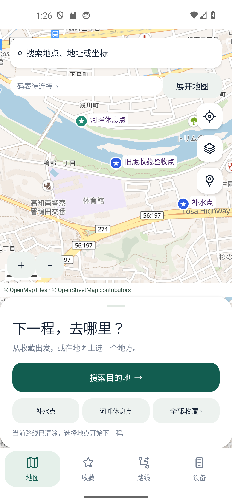
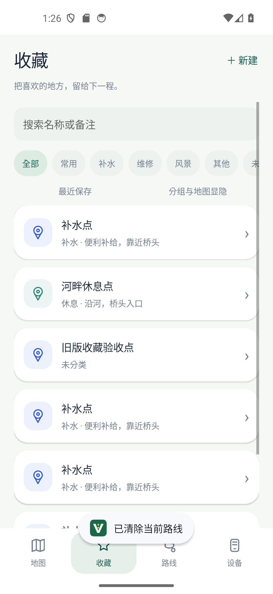
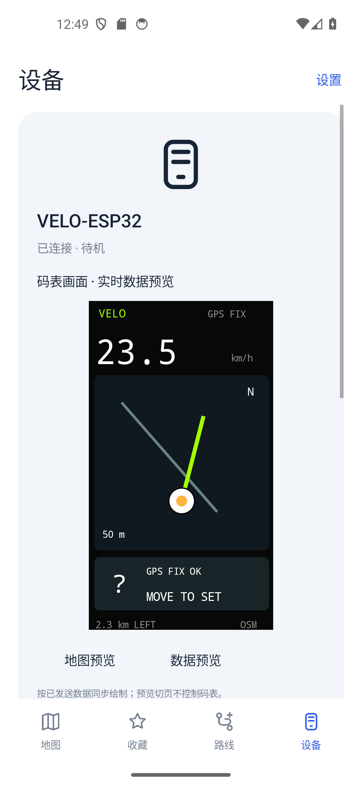
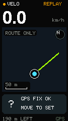
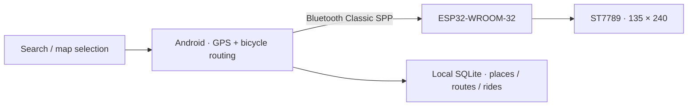

# VELO · ESP32 Bicycle Computer

[简体中文](README.md) · [日本語](README.ja.md) · [English](README.en.md)

> Keep your phone in your pocket and your guidance on the handlebars.

VELO is an experimental bicycle computer system. An Android phone handles place search, bicycle route planning, GPS and navigation. An ESP32 receives updates over Bluetooth Classic and displays speed, a route sketch and turn guidance on a 135×240 screen.

**Status: development prototype for testing, not a production navigation device. Current Android app: 1.0.4. Firmware: 0.10.1. Their version numbers are independent.**

## Interface and hardware

| Android map home | Saved places and groups |
| --- | --- |
|  |  |

| Device data preview | ESP32 map page |
| --- | --- |
|  |  |

Screenshots contain emulator acceptance data and views from different development stages. They do not establish real-device Bluetooth reliability or road safety. The board preview is a redraw of sent data, not a hardware screenshot.

## Implemented features

- In-app place search, decimal/DMS coordinates and long-press map selection.
- Explicit start, destination and up to eight via points for bicycle routing.
- Saved places with groups, notes and colors; GeoJSON import/export.
- Multiple saved routes, renaming, GPX import/export and local ride records.
- Automatic connection to the selected paired computer, reconnect attempts and ride pause/resume.
- Speed, distance, time, route geometry, nearby roads and navigation states on the ESP32.
- Draggable map sheet, expanded map, zoom controls, native ripple feedback and transitions.
- A data-driven board preview after connection; clearing the current route persists across restart.



## Hardware

| Item | Configuration |
| --- | --- |
| Board | Ideaspark ESP32-WROOM-32, USB-C / CH340 |
| Display | Onboard ST7789, 135×240, approximately 1.14 inch |
| Link | Bluetooth Classic SPP, not BLE |
| Position / heading | Phone GPS and actual movement; no external GPS or compass on the board |
| User phone | TCL NXTPAPER 70 Pro |
| Original USB port | COM8; check the port on your new computer |

### Display pins

| Signal | GPIO |
| --- | --- |
| SCLK | 18 |
| MOSI | 23 |
| CS | 15 |
| DC | 2 |
| RST | 4 |
| Backlight | 32, active high |
| Page button | BOOT / GPIO0, active low |

These pins describe the PCB used for this project, not a universal ESP32/ST7789 wiring scheme.

## Continue on a new computer

1. Clone or download the complete repository, preserving its structure.
2. Install `dist/VELO-PhoneBridge-v1.0.4.apk`. Do not uninstall the existing app before an in-place update.
3. Install a JDK (original environment: 20.0.1), Android SDK Platform 35, Build Tools 35.0.0 and Platform Tools. Set `JAVA_HOME` and `ANDROID_SDK_ROOT`.
4. **Transfer the original signing key privately** to `private-signing/velo-test.keystore`. Set `VELO_KEYSTORE_PASSWORD` and `VELO_KEY_PASSWORD`. The key is deliberately absent from GitHub; a different key cannot update an existing installation.
5. For ESP32 development, install Arduino IDE or CLI and `esp32:esp32` 3.3.12. Display library sources are included under `dependencies/arduino-libraries`.

```powershell
# Run PowerShell from the repository root
.\scripts\check-environment.ps1
.\scripts\build-android.ps1
# Compile only; does not flash hardware
.\scripts\firmware.ps1 -Action build
# Flash the included 0.10.1 build; choose your actual port
.\scripts\firmware.ps1 -Action upload -Port COM8
```

See the **[migration and maintenance guide](docs/MIGRATION.md)** for signing, build and phone-data details (Chinese). This is a native Java Views project with a manual Android SDK build; it is **not a Gradle, Compose or Material Components project**.

## Repository layout

```text
android/                 Java source, manifest, resources, bundled MapLibre
firmware/BikeDash/        Arduino sketch and navigation headers
firmware/prebuilt-v0.10.1/  Ready-to-flash firmware binaries
dist/                    Current Android APK
scripts/                 Portable Windows build, flash and test scripts
tests/                   Java / C++ checks and emulator test suites
docs/images/             Screenshots and board captures
docs/history/            Development history (not the current specification)
dependencies/arduino-libraries/  Pinned display-library sources
prototypes/              Original editable interface prototype
```

## Limitations and next steps

- New maps, search and routing require network access. Public free services have different coverage from Google and no guaranteed uptime.
- Travel direction is derived from actual phone movement; rotating the stationary device does not establish heading.
- Foreground location services exist, but extended lock-screen/battery-saver tests on the TCL phone and automatic recovery after process termination remain unfinished.
- The preview cannot confirm what the physical ESP32 actually displayed.
- Private favorites, route databases and ride tracks from the phone are not included. Export needed data on the original phone.
- No CI assurance is configured. Instrumentation tests modify app data and must run on a disposable emulator; some use live network services.

## Validation

The 1.0.4 development run passed 19 route-clearing/UI checks and 59 application integration checks. Repository portability checks are separate from device and road validation.

```powershell
# Disposable Android emulator only; build the app first.
.\scripts\test-android.ps1 -Suite clear -Device emulator-5554
```

## Dependencies and licensing

MapLibre GL JS 5.10.0 renders the phone map. Default services: OpenFreeMap, Photon and BRouter. Preserve attribution and third-party licenses; see [THIRD_PARTY.md](THIRD_PARTY.md). No separate open-source license has been selected for the project-owned code. Public visibility alone does not grant unrestricted reuse.

The reorganized repository has been built and checked independently; see [portability checks](docs/PORTABILITY_CHECK.md).

[Release · APK / ZIP](https://github.com/1xiaohuozi/velo-bike-computer/releases/tag/v1.0.4)
