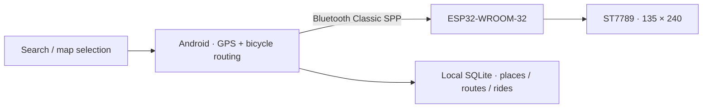

# VELO · ESP32 Bicycle Computer

[简体中文](README.md) · [日本語](README.ja.md) · [English](README.en.md)

> スマートフォンはポケットへ。ナビゲーションはハンドルへ。

VELO は開発中の自転車用サイクルコンピューターです。Android スマートフォンが地点検索、自転車ルートの作成、GPS 測位と案内計算を担当し、ESP32 が Bluetooth Classic 経由で受信した速度、簡易ルート、曲がり角の案内を 135×240 の画面に表示します。

**開発状況：試作・試走検証用です。商用ナビゲーション機器と同等の信頼性を保証するものではありません。Android アプリは 1.0.4、ファームウェアは 0.10.1 です。バージョン番号は別管理です。**

## 画面とハードウェア

| Android の地図ホーム | お気に入りとグループ |
| --- | --- |
|  |  |

| 端末画面のデータプレビュー | ESP32 の地図画面 |
| --- | --- |
|  |  |

画像にはエミュレーターの検証用データと開発途中の画面が含まれます。実機での Bluetooth 動作や道路上の安全性を証明する画像ではありません。プレビューは実画面のキャプチャではなく、送信データの再描画です。

## 実装済みの機能

- アプリ内の地点検索、十進数・度分秒の座標入力、地図の長押し選択。
- 出発地、目的地、最大 8 か所の経由地を明示して自転車ルートを作成。
- お気に入りの名前、グループ、メモ、色の保存と GeoJSON 入出力。
- 複数ルートの保存・名前変更、GPX 入出力、端末内の走行記録。
- 選択したペアリング済み端末への自動接続、再接続、走行の一時停止と再開。
- ESP32 上の速度、距離、時間、ルート、周辺道路と案内状態。
- ドラッグ可能なボトムシート、地図の拡大表示、ズーム操作と画面遷移。
- 接続後の送信データに基づく画面プレビューと、再起動後も維持される現在ルートの消去。



## ハードウェア構成

| 項目 | 構成 |
| --- | --- |
| 開発ボード | Ideaspark ESP32-WROOM-32、USB-C / CH340 |
| ディスプレイ | 内蔵 ST7789、135×240、約 1.14 インチ |
| 通信 | Bluetooth Classic SPP（BLE ではありません） |
| 位置・進行方向 | スマートフォンの GPS と実際の移動。ボードに外付け GPS・コンパスはありません |
| 使用スマートフォン | TCL NXTPAPER 70 Pro |
| 元の USB ポート | COM8。移行先ではポートを再確認してください |

### 画面のピン配置

| 信号 | GPIO |
| --- | --- |
| SCLK | 18 |
| MOSI | 23 |
| CS | 15 |
| DC | 2 |
| RST | 4 |
| バックライト | 32、HIGH で点灯 |
| 画面切替ボタン | BOOT / GPIO0、LOW で押下 |

このピン配置は本プロジェクトで使っている基板用です。他の ESP32 / ST7789 基板にそのまま適用しないでください。

## 別のパソコンで開発を続ける

1. リポジトリ全体をクローン、または ZIP でダウンロードしてください。
2. `dist/VELO-PhoneBridge-v1.0.4.apk` をインストールします。上書き更新する場合、旧アプリを先に削除しないでください。
3. JDK（元の環境は 20.0.1）、Android SDK Platform 35、Build Tools 35.0.0、Platform Tools を用意し、`JAVA_HOME` と `ANDROID_SDK_ROOT` を設定します。
4. **元の署名鍵を非公開の方法で移行**し、`private-signing/velo-test.keystore` に置きます。`VELO_KEYSTORE_PASSWORD` と `VELO_KEY_PASSWORD` を設定してください。鍵は GitHub に含まれません。別の鍵では既存アプリを上書き更新できません。
5. ESP32 の開発には Arduino IDE または CLI と `esp32:esp32` 3.3.12 を使用します。画面用ライブラリのソースは `dependencies/arduino-libraries` に同梱しています。

```powershell
# リポジトリのルートで PowerShell を実行
.\scripts\check-environment.ps1
.\scripts\build-android.ps1
# コンパイルのみ。ボードには書き込みません
.\scripts\firmware.ps1 -Action build
# 同梱の 0.10.1 を書き込み。実際のポートを指定
.\scripts\firmware.ps1 -Action upload -Port COM8
```

署名、ビルド、スマートフォン内データの移行は **[移行・保守ガイド](docs/MIGRATION.md)**（中国語）をご覧ください。現在は Java のネイティブ View と Android SDK の手動ビルド方式であり、**Gradle / Compose / Material Components のプロジェクトではありません**。

## ディレクトリ構成

```text
android/                 Java source, manifest, resources, bundled MapLibre
firmware/BikeDash/        Arduino sketch and navigation headers
firmware/prebuilt-v0.10.1/  Ready-to-flash firmware binaries
dist/                    Current Android APK
scripts/                 Portable Windows build, flash and test scripts
tests/                   Java / C++ checks and emulator test suites
docs/images/             Screenshots and board captures
docs/history/            Development history (not the current specification)
dependencies/arduino-libraries/  Pinned display-library sources
prototypes/              Original editable interface prototype
```

## 制限事項と今後の課題

- 新しい地図・検索・ルート作成には通信が必要です。無料の公開サービスには Google との検索範囲の差があり、稼働保証はありません。
- 進行方向は実際の移動から推定します。停止したまま端末を回しても信頼できる方角は得られません。
- フォアグラウンド位置サービスは実装済みですが、TCL 実機での長時間のロック画面・省電力試験と、プロセス終了後の自動復帰は未完了です。
- データプレビューでは、ESP32 が実際に何を表示したかまでは確認できません。
- スマートフォン内の個人のお気に入り、ルート DB、走行軌跡は含まれません。必要なデータは元の端末から書き出してください。
- CI は未設定です。アプリデータを変更するテストは使い捨てのエミュレーターで実行してください。一部のテストは実際のネットワークサービスを使用します。

## 検証

1.0.4 の開発時にはルート消去・UI の 19 項目とアプリ統合の 59 項目を確認しました。リポジトリ移行の確認と実機・公道での検証は別扱いです。

```powershell
# Disposable Android emulator only; build the app first.
.\scripts\test-android.ps1 -Suite clear -Device emulator-5554
```

## 依存関係とライセンス

スマートフォンの地図描画は MapLibre GL JS 5.10.0 を利用し、既定のサービスは OpenFreeMap、Photon、BRouter です。帰属表示と第三者ライセンスを維持してください。[THIRD_PARTY.md](THIRD_PARTY.md) にまとめています。プロジェクト独自コードのオープンソースライセンスは未選択です。公開されていること自体が自由な再利用の許諾を意味するものではありません。
