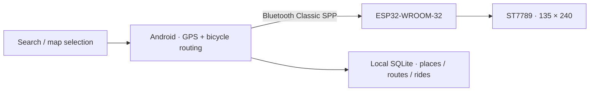

# VELO · ESP32 Bicycle Computer

[简体中文](README.md) · [日本語](README.ja.md) · [English](README.en.md)

> 把手机放进口袋，把导航留在车把上。

VELO 是一套正在开发的自行车码表系统：Android 手机负责地点搜索、自行车路线规划、GPS 定位和导航计算，ESP32 通过经典蓝牙接收数据，在 135×240 小屏幕上显示速度、路线与转向提示。

**项目状态：实验性原型，适合开发与试骑验证，尚不能视为成熟商用导航设备。当前 App 为 1.0.4，固件为 0.10.1；两者版本号独立。**

## 界面与硬件

| Android 地图首页 | 收藏与地点分组 |
| --- | --- |
|  |  |

| 设备页码表数据预览 | ESP32 地图页 |
| --- | --- |
|  |  |

图片包含模拟器验收数据和不同开发阶段的截图，并非实机蓝牙与道路安全验收证明。设备预览不是屏幕截图，不读取码表实际按键页面。

## 已经实现

- 应用内地点搜索、十进制／度分秒坐标输入、地图长按选点。
- 明确选择起点、终点与最多 8 个途经点，规划自行车路线。
- 收藏的名称、分组、备注和颜色；GeoJSON 导入导出。
- 多条路线保存、重命名、GPX 导入导出及本地骑行记录。
- 打开应用后连接已选码表，断线重试；开始、暂停、继续、结束骑行。
- 码表显示速度、里程、时间、路线、周边路网和转向／反向状态。
- 可拖动面板、全屏地图、缩放按钮、原生点击反馈与页面过渡。
- 连接后显示依据已发送数据绘制的码表预览；可清除当前路线且重开不恢复。



## 硬件配置

| 项目 | 配置 |
| --- | --- |
| 开发板 | Ideaspark ESP32-WROOM-32，USB-C / CH340 |
| 显示屏 | 板载 ST7789，135×240，约 1.14 英寸 |
| 通信 | 经典蓝牙 SPP；不是 BLE |
| 定位与航向 | 手机 GPS 及移动轨迹；板上未外接 GPS 或罗盘 |
| 测试手机 | TCL NXTPAPER 70 Pro（用户设备） |
| 原电脑串口 | COM8；换电脑后必须重新确认 |

### 屏幕引脚

| 信号 | GPIO |
| --- | --- |
| SCLK | 18 |
| MOSI | 23 |
| CS | 15 |
| DC | 2 |
| RST | 4 |
| 背光 | 32，高电平亮 |
| 切页按键 | BOOT / GPIO0，低电平按下 |

这些是当前 PCB 已使用的引脚，不是所有 ESP32 + ST7789 模块的通用接线。

## 在新电脑上继续开发

1. 下载仓库 ZIP 或克隆仓库，保留整个目录结构。
2. 直接安装 `dist/VELO-PhoneBridge-v1.0.4.apk`；覆盖安装时不要先卸载旧 App。
3. 安装 JDK（原环境为 20.0.1）、Android SDK Platform 35、Build Tools 35.0.0 和 Platform Tools，设置 `JAVA_HOME` 与 `ANDROID_SDK_ROOT`。
4. **私下转移原签名密钥**，放入 `private-signing/velo-test.keystore`，设置 `VELO_KEYSTORE_PASSWORD` / `VELO_KEY_PASSWORD`。密钥不在 GitHub 中；丢失后无法用新密钥覆盖原安装。
5. ESP32 开发需 Arduino IDE 或 Arduino CLI，以及 `esp32:esp32` 3.3.12。显示驱动库的源码已放在 `dependencies/arduino-libraries`。

```powershell
# 在仓库根目录的 PowerShell 中执行
.\scripts\check-environment.ps1
.\scripts\build-android.ps1
# 仅编译固件，不会烧录
.\scripts\firmware.ps1 -Action build
# 上传已附带的 0.10.1 固件；改成实际串口
.\scripts\firmware.ps1 -Action upload -Port COM8
```

完整迁移、构建、签名、手机数据和维护说明：**[项目迁移手册](docs/MIGRATION.md)**。当前工程使用 Java 原生视图和手动 Android SDK 构建脚本，**不是 Gradle / Compose / Material Components 工程**。

## 目录结构

```text
android/                 Java source, manifest, resources, bundled MapLibre
firmware/BikeDash/        Arduino sketch and navigation headers
firmware/prebuilt-v0.10.1/  Ready-to-flash firmware binaries
dist/                    Current Android APK
scripts/                 Portable Windows build, flash and test scripts
tests/                   Java / C++ checks and emulator test suites
docs/images/             Screenshots and board captures
docs/history/            Development history (not the current specification)
dependencies/arduino-libraries/  Pinned display-library sources
prototypes/              Original editable interface prototype
```

## 使用边界与待办

- 地图、地点搜索和新路线规划依赖网络，公共免费服务没有可用性保证，覆盖不等同于 Google。
- 行进朝向来自手机实际移动；原地旋转不提供可靠朝向。
- 前台定位服务已经实现；TCL 锁屏、省电与后台持续导航尚需实机长时间验证，异常退出后自动恢复未完成。
- Android 预览仅反映已发送内容，不能确认 ESP32 已实际显示。
- 没有随包导出手机中的私人收藏、路线数据库或骑行轨迹；请在原手机先导出需要的数据。
- 当前没有 CI 自动保证；测试脚本仅限可丢弃模拟器，部分测试会联网并修改应用数据。

## 验证

1.0.4 开发记录：19 项清除路线与界面专项检查、59 项应用集成回归通过。迁移检查与实机验收分别记录。

```powershell
# Disposable Android emulator only; build the app first.
.\scripts\test-android.ps1 -Suite clear -Device emulator-5554
```

## 依赖与许可

手机地图使用 MapLibre GL JS 5.10.0，默认服务为 OpenFreeMap、Photon 与 BRouter。保留地图署名与第三方许可，详见 [THIRD_PARTY.md](THIRD_PARTY.md)。本仓库尚未单独授予项目自有代码的开源许可证；公开可见不等于授予任意再许可权。

迁移目录已完成独立构建和检查，见 [迁移验证记录](docs/PORTABILITY_CHECK.md)。

[Release · APK / ZIP](https://github.com/1xiaohuozi/velo-bike-computer/releases/tag/v1.0.4)
